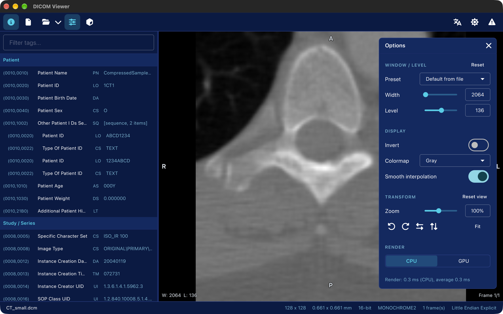
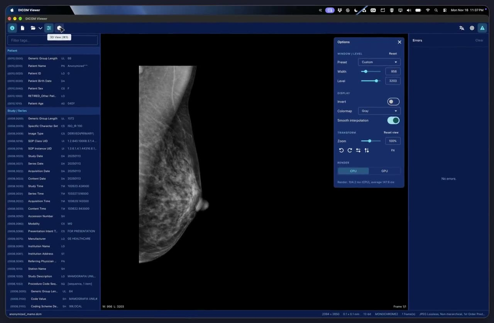
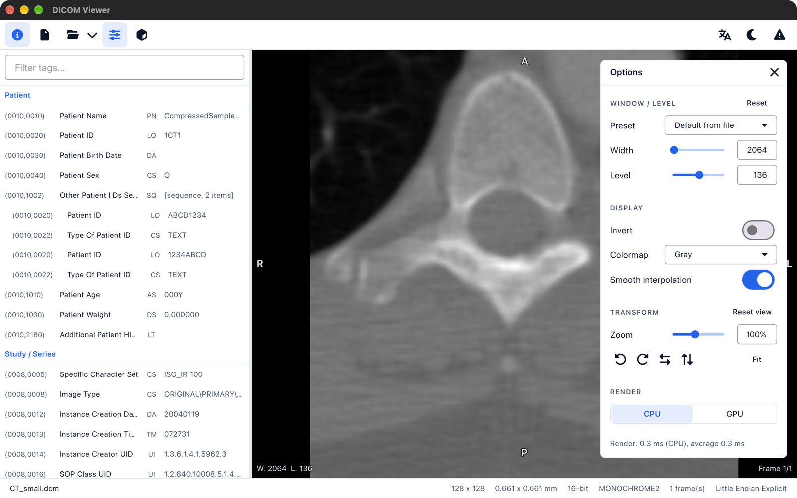
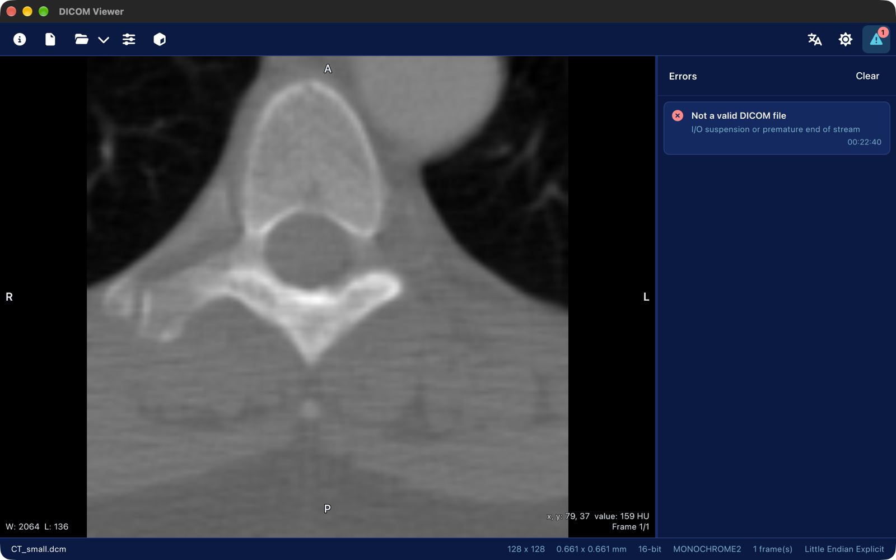
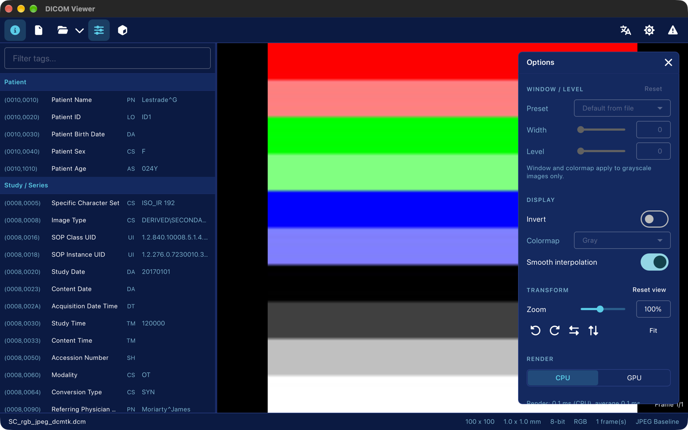
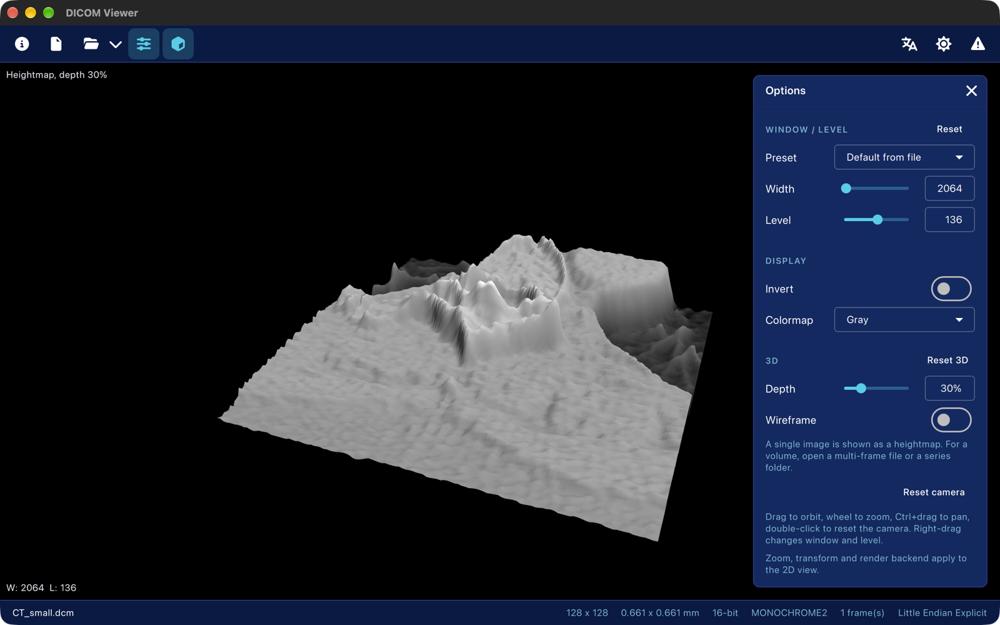
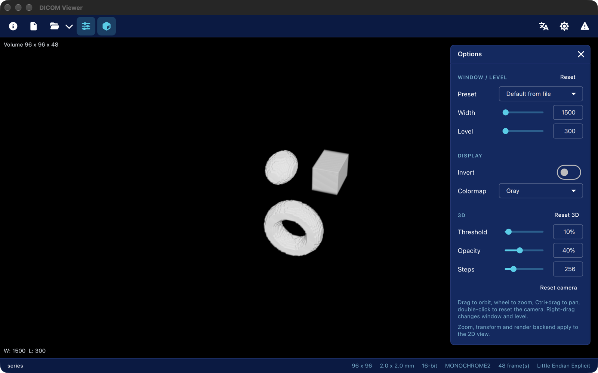
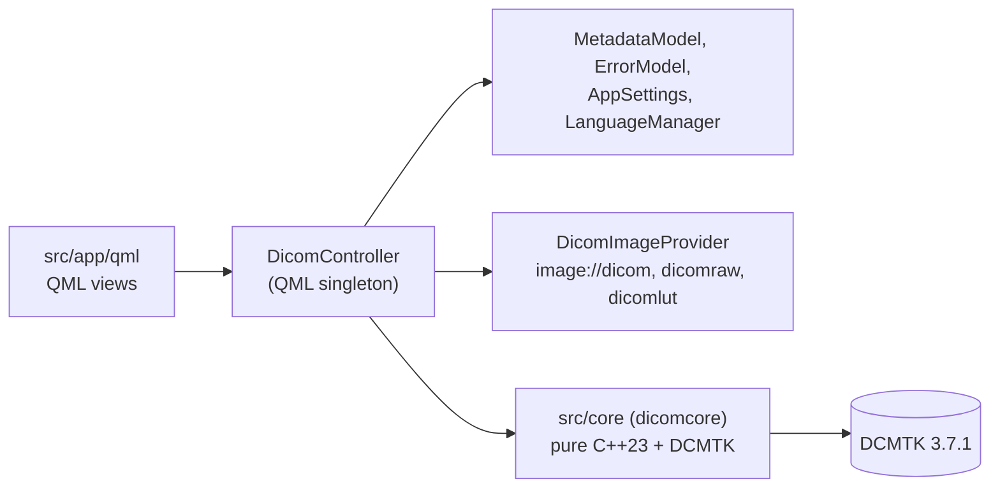

# DICOM Viewer

[English](README.md) | [Português (Brasil)](README.pt-BR.md)

A desktop DICOM viewer written in C++23 with Qt 6.12 (Qt Quick) and DCMTK 3.7.1. It opens a `.dcm` file
(or a folder as a series) from a file dialog, shows the image with the right size, grayscale mapping and
orientation, lets you change window/level, shows the DICOM metadata, and reports invalid files with a clear
error message instead of crashing. Besides the assignment it ships a light/dark theme, an English and
Brazilian Portuguese UI, a GPU rendering path, and a 3D heightmap/volume view.

> **Not for diagnostic use.** This is an educational and technical-test project. It is not a medical device
> and has no regulatory clearance. Never use it for clinical decisions.



[](docs/demo.mp4)

**Demo video** ([docs/demo.mp4](docs/demo.mp4), about 2 min, 5 MB): the splash screen, the empty state with the
example errors, opening a DICOM file, window/level, colormaps and the 3D heightmap, recorded from the real app.

## Contents

[Status](#status) - [Features](#features) - [Screenshots](#screenshots) - [Quick start](#quick-start) -
[Requirements](#requirements) - [Build, run and test](#build-run-and-test) - [Libraries used](#libraries-used) -
[Using the viewer](#using-the-viewer) - [How the image is displayed correctly](#how-the-image-is-displayed-correctly) -
[Error handling](#error-handling) - [Supported files and limitations](#supported-files-and-limitations) -
[Architecture](#architecture) - [Testing](#testing) - [Packaging and CI](#packaging-and-ci) -
[SOUP and SBOM](#soup-and-sbom) - [Sample data](#sample-data) - [Design decisions](#design-decisions) -
[Licence](#licence) - [Project layout](#project-layout)

## Status

| Item | State |
|---|---|
| macOS (Apple Silicon, Apple clang 21, Xcode SDK, Qt 6.12.0) | Verified: clean Release build from the steps below, all 256 tests pass in Debug, the app starts on `tests/data/CT_small.dcm` |
| Windows (MSVC 2022 x64) and Linux (Ubuntu 24.04, GCC 13) | Built and tested by CI: 256 tests pass and a package is produced on each. **Not run on a desktop** by the author, and the steps below follow CI |
| GitHub Actions, release packages | Every push builds, tests and packages on macOS, Windows and Linux, and uploads the packages as workflow artifacts. The `release` job (GitHub Release) only runs on a `v*` tag, so **no release has been published yet** |
| Code signing / notarization | None. Packages are unsigned (macOS ad-hoc only) |

## Features

The assignment asks for a C++17+ app that picks a DICOM file in a GUI dialog, loads it and shows it correctly
(dimensions, grayscale, orientation), with a viewing area and an error message for invalid files.

| Requirement | Where it is |
|---|---|
| File dialog to pick a `.dcm` | Toolbar "Open file" (`Ctrl+O`); filter `*.dcm *.dicom` or all files. Also drag and drop and a command-line argument |
| Load and show the image | DCMTK `DicomImage` decodes, applies modality LUT and window; shown in a Qt Quick viewport |
| Correct dimensions | Rendered at columns x rows; shown in the status bar; zoom, pan and fit |
| Grayscale | 8 to 16 bit monochrome, MONOCHROME1 and MONOCHROME2, rescale slope/intercept, VOI window |
| Orientation | R/L/A/P/H/F letters from Image Orientation Patient; they follow rotate and flip |
| Viewing area and basic GUI | Toolbar, metadata panel, viewport, Options pane, Errors panel, status bar |
| Error message for invalid files | Typed error codes, translated message, technical detail, Errors panel; the previous image stays |
| **Optional:** Window Level/Width | Sliders, numeric fields, presets, right-drag in the viewport |
| **Optional:** DICOM metadata | Filterable tag table grouped by Patient, Study/Series and Image, with sequences expanded |
| **Optional:** RGB | RGB and YBR colour images, uncompressed or JPEG/RLE compressed |
| Extra: themes, languages | Light/dark (follows the system on first run) and English / Portuguese (BR), switched at run time and remembered |
| Extra: GPU rendering | CPU or GPU path for window, level, invert and colormap, with render timing |
| Extra: 3D | Heightmap for one image, ray-marched volume for a multi-frame file or a series folder |
| Extra: series | Open a folder; slices are filtered by Series Instance UID and sorted by position |
| Extra: packaging, SOUP/SBOM, CI | DMG / ZIP / AppImage / tar.gz, source inventories, GitHub Actions workflow |

Also: invert, four colormaps (Gray, Bone, Hot, Jet), smooth or nearest interpolation, rotate and flip, a splash
screen with the library versions, and background loading with a busy indicator.

## Screenshots

| | |
|---|---|
|  Light theme |  Portuguese (BR) UI |
|  A text file opened as DICOM: the error is listed and the previous CT stays on screen |  RGB image (JPEG Baseline) |
|  3D heightmap of a single image |  3D volume of a synthetic 48-slice series (sphere, cube, torus) |

The screenshots were grabbed from the real QML application (Release build) on macOS (Metal), window 1280 x 800. The volume series
was generated by a throwaway script (a sphere, a cube and a torus in air); it is not committed. The metadata panel shows the
standard DICOM tag names from DCMTK's dictionary, which stay in English in the Portuguese UI. The splash
screen is not pictured.

## Quick start

**Option 1 - release packages.** Once a `v*` tag has been pushed, CI attaches `.dmg` (macOS), `.zip`
(Windows), `.AppImage` and `.tar.gz` (Linux) to the GitHub Release. None has been published yet (see
[Status](#status)). The packages are unsigned: on macOS use Finder right-click > Open the first time.

**Option 2 - build from source** (details [below](#build-run-and-test)). On macOS with Qt 6.12.0 installed
in `~/Qt`:

```sh
git clone https://github.com/SauloRamos1/dicom-viewer.git && cd dicom-viewer
export CMAKE_PREFIX_PATH="$HOME/Qt/6.12.0/macos" PATH="$HOME/Qt/Tools/Ninja:$PATH"
cmake --preset release && cmake --build --preset release && ctest --preset release
build/release/src/app/appDicomViewer.app/Contents/MacOS/appDicomViewer tests/data/CT_small.dcm
```

## Requirements

| Requirement | Version / notes |
|---|---|
| Qt | **6.12.0** (official installer or `aqtinstall`). Modules linked by CMake: Quick, QuickControls2 (Material style), Quick3D, Concurrent, Svg. Build tools: ShaderTools (`qsb`) and LinguistTools. `QtQuick.Dialogs` (QuickDialogs2) is loaded at run time. In the installer also select **Qt Quick 3D**, **Qt Shader Tools** and Qt Quick Timeline if they are not already ticked (CI installs the latter because Quick 3D recommends it; the app does not link it) |
| CMake | 3.24 or newer |
| Generator | Ninja (the presets use it). The Qt installer ships it in `Tools/Ninja` |
| C++ compiler | C++23 with `std::expected`. Used locally: Apple clang 21 (Xcode). Built and tested by CI: GCC 13 (Linux) and MSVC 2022 x64 (Windows) |
| Network | The first configure downloads DCMTK 3.7.1 and Catch2 v3.16.1 with `FetchContent` (pinned tags) |
| macOS | Deployment target is read from Qt (14.4 for Qt 6.12). Xcode, not only the Command Line Tools |
| Linux | Ubuntu 24.04 or newer (glibc 2.39 baseline). CI installs: `gcc-13 g++-13 ninja-build libgl1-mesa-dev libxkbcommon-x11-0 libxcb-cursor0 libxcb-icccm4 libxcb-image0 libxcb-keysyms1 libxcb-randr0 libxcb-render-util0 libxcb-shape0 libxcb-xfixes0 libxcb-xinerama0 libxcb-xkb1` |
| GPU (optional) | Any Metal, Direct3D, Vulkan or OpenGL device Qt Quick can use. Without one the viewer falls back to the CPU path and says so |

No package manager (vcpkg, Conan) is needed. If a DCMTK 3.7 or Catch2 3 package is already installed, CMake
uses it instead of downloading.

## Build, run and test

The committed [CMakePresets.json](CMakePresets.json) has two presets, `debug` and `release`, both using
Ninja and building into `build/<preset>`. Qt is found through `CMAKE_PREFIX_PATH`. The first build compiles
DCMTK from source, which takes several minutes.

### macOS

```sh
export CMAKE_PREFIX_PATH="$HOME/Qt/6.12.0/macos"      # Qt kit from the official installer
export PATH="$HOME/Qt/Tools/Ninja:$PATH"              # or: brew install ninja
cmake --preset release
cmake --build --preset release
ctest --preset release                                 # 256 tests, a few seconds
build/release/src/app/appDicomViewer.app/Contents/MacOS/appDicomViewer tests/data/CT_small.dcm
```

Run without the file argument to start empty and use the Open button. Starting the `.app` with `open` works
too, but pass an absolute path:
`open build/release/src/app/appDicomViewer.app --args "$PWD/tests/data/CT_small.dcm"`.

**Linker error `ld: tapi error: malformed file ... libSystem.tbd`?** CMake picked a broken Command Line Tools
SDK (seen with a macOS 27 beta). Point CMake at the Xcode SDK once, at configure time:

```sh
cmake --preset release -DCMAKE_OSX_SYSROOT="$(xcrun --sdk macosx --show-sdk-path)"
```

(If `xcode-select -p` prints `/Library/Developer/CommandLineTools`, also run
`sudo xcode-select -s /Applications/Xcode.app/Contents/Developer`.)

**Keep machine settings out of the repo.** Put the Qt path and SDK in a `CMakeUserPresets.json` next to
`CMakePresets.json` (it is git-ignored) and select it by name:

```json
{
  "version": 6,
  "configurePresets": [
    {
      "name": "local", "inherits": "release", "binaryDir": "${sourceDir}/build/local",
      "cacheVariables": {
        "CMAKE_PREFIX_PATH": "$env{HOME}/Qt/6.12.0/macos",
        "CMAKE_OSX_SYSROOT": "/Applications/Xcode.app/Contents/Developer/Platforms/MacOSX.platform/Developer/SDKs/MacOSX.sdk"
      }
    }
  ],
  "buildPresets": [{ "name": "local", "configurePreset": "local" }],
  "testPresets": [{ "name": "local", "configurePreset": "local", "output": { "outputOnFailure": true } }]
}
```

```sh
cmake --preset local && cmake --build --preset local && ctest --preset local
```

### Linux (built and tested by CI, not run on a desktop by the author)

```sh
sudo apt-get install -y gcc-13 g++-13 ninja-build libgl1-mesa-dev libxkbcommon-x11-0 libxcb-cursor0   # plus the other libxcb-* packages listed above
export CC=gcc-13 CXX=g++-13 CMAKE_PREFIX_PATH="$HOME/Qt/6.12.0/gcc_64"
cmake --preset release && cmake --build --preset release && ctest --preset release
build/release/src/app/appDicomViewer tests/data/CT_small.dcm
```

Over SSH or in CI, run with `QT_QPA_PLATFORM=offscreen` (the 3D view needs a real GPU context and shows
nothing offscreen).

### Windows (built and tested by CI, not run on a desktop by the author)

In an "x64 Native Tools Command Prompt for VS 2022" (Ninja comes with Visual Studio's CMake, or from Qt's `Tools`):

```bat
set CMAKE_PREFIX_PATH=C:\Qt\6.12.0\msvc2022_64
set PATH=%CMAKE_PREFIX_PATH%\bin;%PATH%
cmake --preset release
cmake --build --preset release
ctest --preset release
build\release\src\app\appDicomViewer.exe tests\data\CT_small.dcm
```

### Notes for every platform

- `debug` builds define `QT_QML_DEBUG` so Qt's QML preview and profiler tools can attach.
- To skip the tests (and Catch2): `-DDICOMVIEWER_BUILD_TESTS=OFF` at configure time.

## Libraries used

| Library | Version | Used for | Licence |
|---|---|---|---|
| Qt Quick, Quick Controls 2 (Material), Quick Dialogs 2 | 6.12.0 | UI, native file and folder dialogs | LGPL-3.0-only |
| Qt Quick 3D | 6.12.0 | 3D heightmap and volume | GPL-3.0-only or commercial |
| Qt Concurrent | 6.12.0 | Loading and rendering off the GUI thread | LGPL-3.0-only |
| Qt Svg | 6.12.0 | Splash icon | LGPL-3.0-only |
| Qt Shader Tools, Linguist Tools | 6.12.0 | Build time: `qsb` shaders, `.ts` to `.qm` | build tools |
| **DCMTK** | **3.7.1** | DICOM parsing and imaging, built static. Modules: `dcmdata` (file, tags, transfer syntaxes, RLE), `dcmimgle` (`DicomImage`: modality LUT, VOI, MONOCHROME1/2), `dcmimage` (RGB, YBR, palette), `dcmjpeg` (JPEG), `dcmjpls` (JPEG-LS), plus `ofstd`, `oflog`, `oficonv` | BSD-3-Clause (bundled IJG, CharLS, oficonv notices) |
| Catch2 | 3.16.1 | Tests only, not shipped | BSL-1.0 |
| Font Awesome Free | 7.3.1 (Solid) | Toolbar icons, as an embedded font | OFL-1.1 |
| pydicom test files | - | Test fixtures only, not shipped | MIT |

Qt version used: **6.12.0**. DCMTK is built without zlib, libpng, libtiff, OpenJPEG, OpenSSL and iconv.
Full table with sources: [docs/SOUP.md](docs/SOUP.md).

## Using the viewer

**Opening files**

- Toolbar folder button or `Ctrl+O`: pick a file. The chevron next to it (or `Ctrl+Shift+O`) offers
  "Open folder (series)...".
- Drag a file (or a folder) onto the window.
- Command line: `appDicomViewer path/to/file.dcm` or a folder path. The first argument not starting with `-` is used.
- `Ctrl+N` (New) closes the file and resets the viewer.

**Viewport (2D)**

| Action | Effect |
|---|---|
| Mouse wheel / trackpad scroll | Zoom around the cursor |
| Left-drag | Pan |
| Right-drag | Window width (horizontal) and level (vertical), grayscale only |
| Hover | Readout at the bottom-right: pixel `x, y` and its value (HU for CT, plain modality value otherwise, `R G B` for colour); hidden outside the image and while dragging |
| Double-click | Fit to window |
| `R` / `Shift+R` | Rotate 90 degrees right / left (orientation letters follow) |
| `H` / `V` | Flip horizontally / vertically |
| Arrow keys, `PageUp` / `PageDown` | Previous / next frame or slice |

**3D view** (`Ctrl+3`): left-drag orbits, wheel zooms, `Ctrl`+drag pans, double-click resets the camera, and
right-drag still changes window and level. The Options pane has Depth and Wireframe (heightmap) or
Threshold, Opacity and Steps (volume).

**Toolbar shortcuts**

| Shortcut | Action |
|---|---|
| `Ctrl+O` / `Ctrl+Shift+O` | Open file / open folder as series |
| `Ctrl+N` | New (reset) |
| `Ctrl+I` | Show or hide the metadata panel |
| `Ctrl+,` | Show or hide the Options pane (`Esc` closes it while it has focus) |
| `Ctrl+3` | Toggle 2D / 3D |
| `Ctrl+E` | Show or hide the Errors panel (the badge counts its entries) |
| `Ctrl+T` | Switch light / dark theme |

The language menu (translate icon, top right) switches English / Portuguese (BR) immediately.

**Options pane** (draggable by its header): window/level presets (Default from file, Min-Max, CT Brain,
CT Lung, CT Bone, CT Abdomen), Width and Level, Invert, Colormap, Smooth interpolation, zoom, rotate, flip,
Fit, the CPU/GPU switch with the last render time, and the 3D controls.

**Metadata panel**: tags grouped into Patient, Study / Series and Image, with VR and value; sequences are
expanded; the filter field matches tag, name or value.

**Status bar**: file name, columns x rows, bits stored, photometric interpretation, frame count, transfer syntax.

## How the image is displayed correctly

Decoding and the grayscale pipeline are done by DCMTK's `DicomImage` (see `src/core/Windowing.cpp`), not
re-implemented:

1. **Pixel data** of the chosen frame is decoded (uncompressed, RLE, JPEG, JPEG-LS).
2. **Modality transform**: Rescale Slope/Intercept (or a Modality LUT) turns stored values into modality
   values such as Hounsfield units.
3. **VOI window**: Window Center/Width from the file (first window) or a preset, applied with the DICOM linear
   function; the 8-bit result drives the display. A file without window tags falls back to Min-Max.
4. **Photometric interpretation**: MONOCHROME1 is shown inverted relative to MONOCHROME2 (minimum = white);
   RGB, YBR_FULL and YBR_FULL_422 are converted to RGB by DCMTK; the user "Invert" toggle is applied on top.
5. **Geometry**: the image is drawn at its physical proportions: columns x rows, stretched by the pixel
   aspect (column spacing / row spacing from Pixel Spacing, else Imager Pixel Spacing, else Pixel Aspect
   Ratio, else 1), then fitted; zoom stays relative to the fit. The status bar shows the spacing in mm. The
   cursor readout inverts fit, zoom, pan, rotation, flips and pixel aspect (`src/core/ViewGeometry.cpp`).
   **Orientation letters**
   (`src/core/Orientation.cpp`) come from Image Orientation Patient (0020,0037): the row vector gives the
   right edge, the column vector the bottom edge; letters are R/L, A/P, H/F, with secondary letters above 0.2
   for oblique planes. Rotate and flip update them.

**Two render paths, same pixels.** The CPU path produces an 8-bit `QImage` from `DicomImage`. The GPU path
uploads the raw 16-bit values once (packed as high/low byte into an RGBA8 texture, so it works the same on
Metal, Direct3D, Vulkan and OpenGL) and a fragment shader applies slope/intercept, window, invert and
colormap, so dragging the window is cheap. The shader follows DCMTK's truncation. Measured on the real Metal
scene graph, grayscale output differs from the CPU path by at most 1 gray level (where float32 versus double
lands on an integer boundary), a few levels where a 1-level change crosses a steep colormap entry, and a few
isolated texel rows differ with nearest-neighbour minification. Colour, 32-bit, Modality-LUT-sequence and non-linear-VOI images, and series with mixed rescale, always use the CPU
path and the Render section says so. If the GPU path cannot run (software or null renderer, shader failure)
the controller falls back to CPU and adds an Info entry to the Errors panel. The choice is remembered. Render
times are shown in the Options pane; the GPU timing includes waiting for the next frame, so compare it with
the CPU value only roughly. For a controlled comparison run `dicomcore_tests "[!benchmark][gpu]"` from a
release build.

## Error handling

Core functions return `std::expected<T, DicomError>`; no exception crosses into QML. Each `DicomError` has a
code, a severity, a short message, a technical detail (the DCMTK `OFCondition` text) and an optional tag.

| Code | Meaning |
|---|---|
| `FileNotFound`, `FileUnreadable` | Path missing, or not a readable regular file |
| `NotDicom` | DCMTK cannot parse the file (text file, random bytes, truncated file) |
| `NoPixelData` | Valid DICOM without Pixel Data (7FE0,0010): the metadata is shown, no image |
| `UnsupportedTransferSyntax` | JPEG 2000, Deflated, or another syntax this build cannot decode |
| `UnsupportedPhotometric`, `UnsupportedPixelFormat`, `CorruptPixelData`, `DecodeFailed` | The image cannot be built or decoded (`UnsupportedPixelFormat`: BitsAllocated other than 8, 16 or 32, e.g. 1-bit) |
| `VolumeInconsistent`, `VolumeTooLarge`, `FrameOutOfRange` | Series slices differ in size, orientation, pixel spacing or are not evenly spaced; the volume would need more than 2 GiB; bad frame index |
| `NoDicomFiles` | A series folder holds nothing that opens as a DICOM image |
| `GpuUnavailable`, `SingleSliceSeries` | Info notices, not failures |
| `SkippedFiles` | Warning: damaged images of a series folder were left out (the first few are named) |

In the UI each code maps to a translated message plus the technical detail, shown in the **Errors panel**
(right side, `Ctrl+E`, with a count badge). Before any file is opened the panel lists sample errors marked
"Example", which the badge does not count. A failed load replaces them with the real error, opens the panel, and
**keeps the previously opened image, metadata and window untouched**; a successful load clears the list.
Loading and rendering run on worker threads. Starting a new load, or New, makes any load still in flight
obsolete.

## Supported files and limitations

| Transfer syntax | Supported |
|---|---|
| Implicit VR Little Endian, Explicit VR Little Endian, Explicit VR Big Endian | Yes |
| RLE Lossless | Yes |
| JPEG Baseline and Extended (process 1, 2 and 4), JPEG Lossless (process 14, 14 SV1) | Yes (`dcmjpeg`) |
| JPEG-LS Lossless and Near-Lossless | Yes (`dcmjpls`) |
| JPEG 2000, HTJ2K | **No**: `UnsupportedTransferSyntax` |
| Deflated Explicit VR Little Endian | **No**: DCMTK is built without zlib |

Other known limitations:

- Colour images, 32-bit images, Modality LUT sequences, the SIGMOID and LINEAR_EXACT VOI functions and series
  whose slices differ in rescale, signedness or polarity are rendered on the CPU path only.
- Non-square pixels are corrected in the 2D view only; the 3D heightmap is built on the image grid.
- Text is converted to UTF-8 only for ISO_IR 100 (Latin-1), ISO_IR 192 (UTF-8) and ASCII. Other Specific
  Character Sets (Cyrillic, Greek, Japanese, ...) are shown as UTF-8 when already valid and as Latin-1
  otherwise, so they never corrupt the display but their accents or letters can be wrong; only the first value
  of a multi-valued Specific Character Set is used and ISO 2022 escape sequences are not interpreted.
- The cursor readout shows modality values (Rescale Slope/Intercept, or the Modality LUT when the file has
  one; 8 and 16-bit only) and, for colour images, the displayed 8-bit RGB values; it is 2D only.
- Series loading keeps single-frame monochrome slices of the most common Series Instance UID and requires one
  orientation, one pixel spacing and evenly spaced, distinct slice positions (otherwise `VolumeInconsistent`). A volume is
  capped at 128 MB and 2048 voxels per side by averaging blocks; the Options pane shows the factor.
- Not a PACS client: no DICOMDIR, networking, annotations, measurements or multiplanar reformatting.

## Architecture



| Layer | Folder | Notes |
|---|---|---|
| Core | [src/core](src/core) | No Qt GUI types, unit-testable. `DicomFile` (load, `ImageInfo`, codec registration), `Windowing` (presets, `renderFrame`, invert, colormaps), `Metadata`, `Orientation`, `Volume` (multi-frame and series), `Heightmap`, `GpuTexture` / `VolumeGpu` (texture packing), `DicomError` |
| Qt glue | [src/app](src/app) | `DicomController` (state, loading, W/L, frame, render backend), `DicomImageProvider`, `MetadataModel`, `ErrorModel` / `ErrorText`, `AppSettings`, `LanguageManager`, `HeightmapGeometry`, `VolumeTexture` |
| QML | [src/app/qml](src/app/qml) | `Main.qml` (splash and window), `MainView`; `Panels/` (`TopBar`, `MetadataPanel`, `ErrorsPanel`, `StatusBar`), `Viewer/` (`ViewerPane`, `View2D`, `Viewport3D`), `Options/` (`OptionsPane` and its sections), `Components/` (reusable controls), `Style/` (`Theme`) |
| Shaders | [src/app/shaders](src/app/shaders) | `windowing.frag` (GPU 2D path, compiled by `qsb` for every backend); `volume.vert` / `volume.frag` (Quick 3D material snippets for the ray marcher) |
| Translations | [i18n](i18n) | `dicomviewer_pt_BR.ts`, compiled to `.qm` by `qt_add_translations` |

The Qt glue sources are compiled twice from the same files: into the app and into the `dicomapp_tests`
executable, so the controller can be tested without a QML module.

## Testing

```sh
ctest --preset release                                    # all tests (three Catch2 executables)
build/release/tests/dicomcore_tests                       # core unit tests and core BDD scenarios
build/release/tests/dicomapp_tests                        # controller, models, image provider, 3D data
build/release/tests/dicomcore_tests "[!benchmark][gpu]"   # CPU render vs GPU packing benchmark (use a release build)
```

- **Unit tests** ([tests/unit](tests/unit), [tests/app](tests/app)): valid CT/MR and every supported
  transfer syntax, error codes for not-DICOM, empty, truncated and missing files, no pixel data, JPEG 2000 and
  Deflated rejection, MONOCHROME1 inversion, RGB/YBR pixels, window math, slope/intercept to HU, metadata,
  orientation labels, volume and series building, heightmap, GPU texture packing against the shader math,
  controller state, models, settings, language switching, GPU fallback.
- **BDD scenarios** ([tests/features](tests/features), steps in [tests/bdd](tests/bdd)): the `.feature` files
  are the readable specification; each scenario is mirrored by hand as a Catch2 `SCENARIO` / `GIVEN` /
  `WHEN` / `THEN` block (no Gherkin runner parses them).
- Invalid fixtures (empty, random bytes, truncated, no pixel data, MONOCHROME1, series) are generated at
  run time; valid fixtures are in [tests/data](tests/data).
- **QML smoke test** ([tests/qml](tests/qml), `dicomapp_qml_tests`): loads the real `Main` / `MainView` from
  the QML module on the offscreen platform, opens a file and a series, toggles the Metadata, Errors, Options
  and 3D views, switches theme and language, and fails on any QML warning or error (the notices of the
  offscreen platform and "Qt Quick 3D cannot render without an RHI" are the only ones filtered).
- **Not covered by automated tests:** how the interface looks (layout, animations, dialogs). It was checked
  during development with a screenshot harness that drives the real window, which is not committed.

## Packaging and CI

[.github/workflows/build.yml](.github/workflows/build.yml) builds, tests and packages on macOS (arm64),
Windows (MSVC 2022 x64) and Ubuntu 24.04, caches DCMTK, uploads one artifact per platform, and attaches them
to a GitHub Release on `v*` tags. CPack makes a DMG (macOS), a ZIP (Windows) and a tar.gz (Linux); an AppImage
is built by [packaging/linux/build-appimage.sh](packaging/linux/build-appimage.sh). Runtime installs include
the licence texts and both SBOMs. Details, assumptions and the local macOS package check:
[packaging/README.md](packaging/README.md). Only macOS packaging was run locally.

## SOUP and SBOM

- [docs/SOUP.md](docs/SOUP.md): inventory of third-party software with versions, licences and intended use.
- [docs/SBOM.md](docs/SBOM.md) and [docs/sbom/](docs/sbom): CycloneDX 1.6 and SPDX 2.3 JSON. They are
  source-based, not a complete audit of Qt's transitive dependencies.
- [packaging/THIRD_PARTY_NOTICES.md](packaging/THIRD_PARTY_NOTICES.md): notices shipped with the packages.

## Sample data

[tests/data](tests/data) holds small public test files from the pydicom project (MIT) covering CT, MR,
several compressed syntaxes, RGB and YBR, plus a JPEG 2000 and a Deflated file that must fail with
`UnsupportedTransferSyntax`. The file table, origin and licence text are in [tests/data/README.md](tests/data/README.md).
Open any of them to try the viewer.

## Design decisions

- **DCMTK instead of GDCM or hand-written parsing:** `DicomImage` already implements the modality LUT, VOI,
  MONOCHROME1 and colour conversions the assignment is about, and ships JPEG, JPEG-LS and RLE codecs. The
  code adds orientation, volume and GPU paths around it. DCMTK also builds with plain CMake through `FetchContent`.
- **`std::expected<T, DicomError>`** in the core: errors are values with a code, so the UI can translate and
  test them; no exception crosses the QML boundary.
- **`FetchContent` with `FIND_PACKAGE_ARGS`, no package manager:** one tool (CMake) plus Qt; an installed
  copy is used when present, otherwise the pinned tag is built.
- **Catch2 v3 with BDD-style scenarios:** one framework for unit and behaviour tests, run by `ctest`.
- **Packing 16-bit values for the shader:** Qt Quick textures are 8 bits per channel and integer or R16
  textures are not portable for 2D, so a frame goes up as high byte / low byte in RGBA8 and the shader
  rebuilds the stored value. The 3D volume uses a filterable R16 unorm 3D texture instead.
- **Core without Qt GUI types:** the DICOM logic can be tested and reused without a window.

## Licence

The project is licensed under **GPL-3.0-only**; the full text is in [LICENSE](LICENSE). Qt Quick 3D, which the
3D view needs, is available under GPL-3.0-only or a commercial licence (not LGPL), so the combined work is
distributed under GPLv3. The other Qt modules are used under the LGPLv3 option, DCMTK is BSD-3-Clause, Font
Awesome Free is OFL-1.1, and the test files are MIT. Per-component notices:
[packaging/THIRD_PARTY_NOTICES.md](packaging/THIRD_PARTY_NOTICES.md).

## Project layout

```text
CMakeLists.txt, CMakePresets.json     build entry points (CMakeUserPresets.json is local, git-ignored)
cmake/Dependencies.cmake              DCMTK and Catch2 via FetchContent
src/core/                             DICOM core (no Qt GUI)
src/app/                              Qt glue, main.cpp
src/app/qml/                          QML UI: Main, MainView, Splash at the top, then
  Style/                                Theme and FontAwesome singletons
  Components/                           reusable controls (Icon, IconButton, Panel, SliderField, ...)
  Panels/                               TopBar, MetadataPanel, ErrorsPanel, StatusBar
  Viewer/                               View2D, GpuImage, Viewport3D and the 3D models
  Options/                              Options pane and its sections
src/app/shaders/                      windowing.frag, volume.vert/.frag
src/app/resources/                    Font Awesome font, app icon
i18n/                                 Portuguese (BR) translation
tests/unit, tests/app, tests/bdd      Catch2 tests
tests/features/                       BDD feature files
tests/data/                           sample DICOM files (+ README, licence)
docs/                                 SOUP.md, SBOM.md, sbom/, images/, demo.mp4
packaging/                            icons, Info.plist, AppImage script, notices, packaging README
.github/workflows/build.yml           CI and release workflow
```
