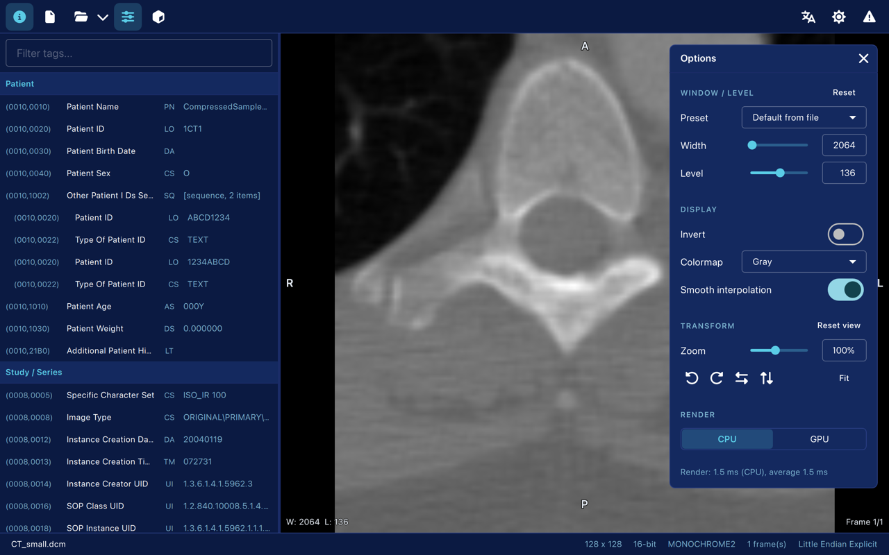
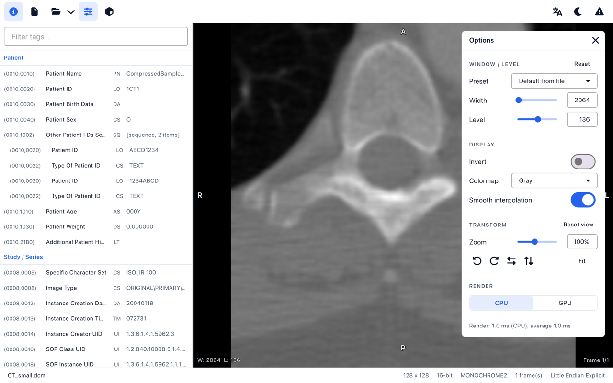
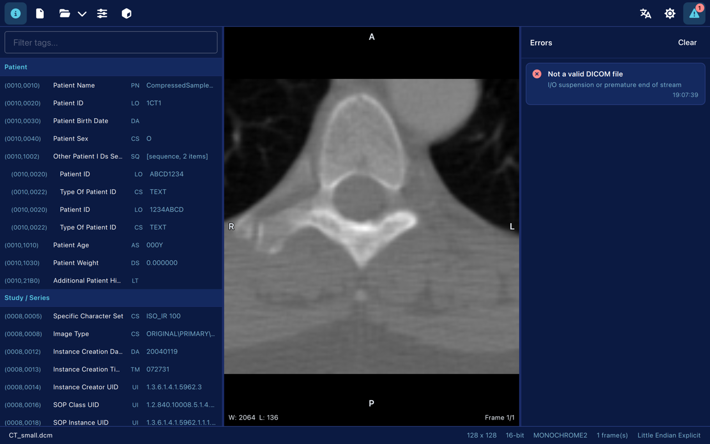
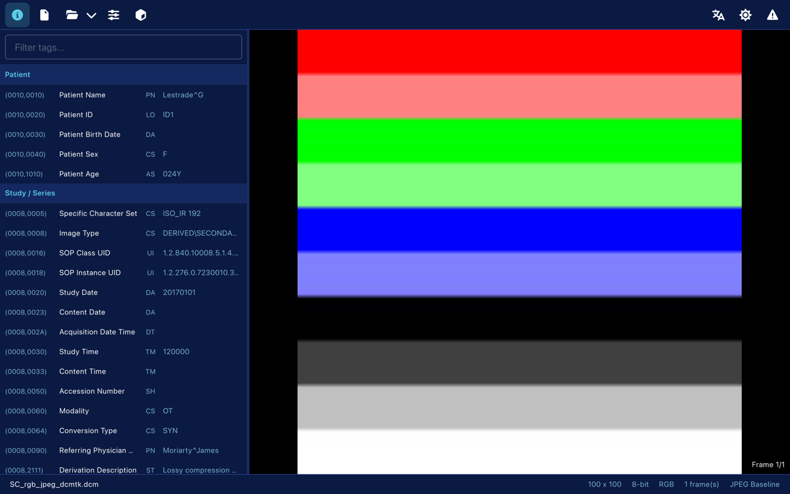
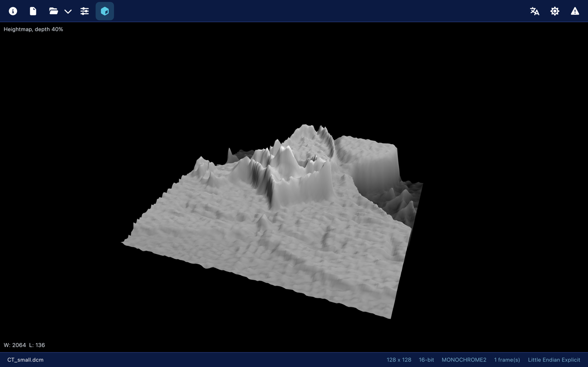
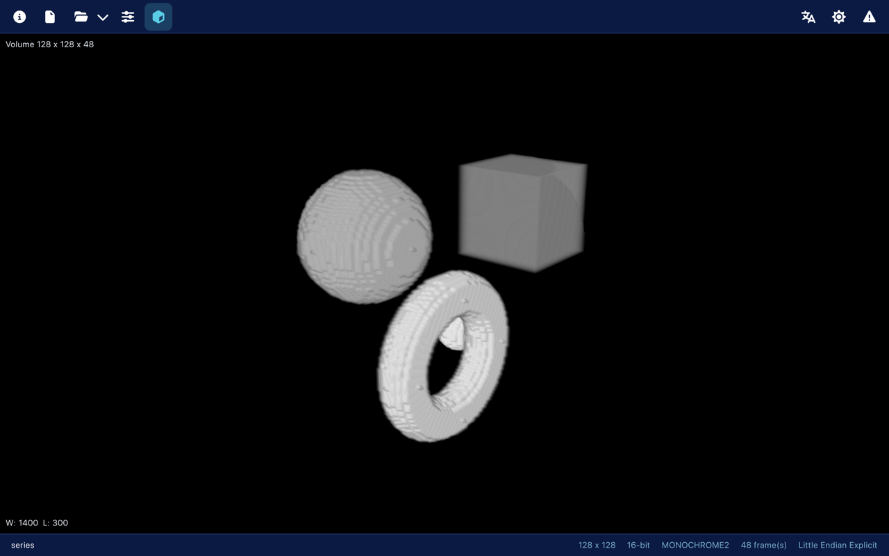
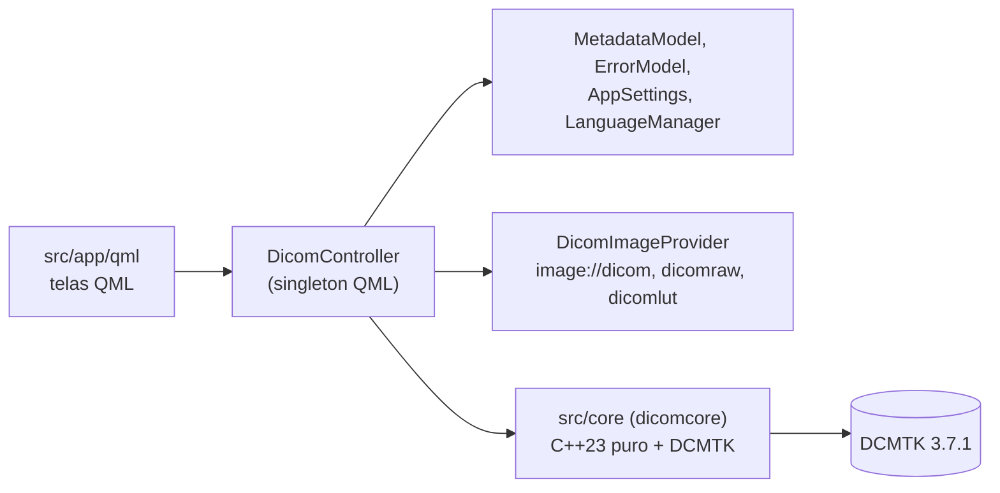

# DICOM Viewer

[English](README.md) | [Português (Brasil)](README.pt-BR.md)

Visualizador DICOM para desktop, escrito em C++23 com Qt 6.12 (Qt Quick) e DCMTK 3.7.1. Ele abre um arquivo
`.dcm` (ou uma pasta como série) por uma janela de seleção de arquivo, mostra a imagem com o tamanho, o
mapeamento de cinza e a orientação corretos, permite ajustar janela e nível, exibe os metadados DICOM e
informa arquivos inválidos com uma mensagem de erro clara, sem travar. Além do que o teste pede, o projeto traz
tema claro/escuro, interface em inglês e português do Brasil, renderização por GPU e uma visão 3D
(mapa de altura e volume).

> **Não use para diagnóstico.** Este é um projeto educacional e de teste técnico. Não é um dispositivo médico
> e não tem nenhuma certificação regulatória. Nunca use para decisões clínicas.



## Sumário

[Situação](#situação) - [Recursos](#recursos) - [Capturas de tela](#capturas-de-tela) - [Início rápido](#início-rápido) -
[Requisitos](#requisitos) - [Compilar, executar e testar](#compilar-executar-e-testar) - [Bibliotecas utilizadas](#bibliotecas-utilizadas) -
[Usando o visualizador](#usando-o-visualizador) - [Como a imagem é exibida corretamente](#como-a-imagem-é-exibida-corretamente) -
[Tratamento de erros](#tratamento-de-erros) - [Arquivos suportados e limitações](#arquivos-suportados-e-limitações) -
[Arquitetura](#arquitetura) - [Testes](#testes) - [Empacotamento e CI](#empacotamento-e-ci) -
[SOUP e SBOM](#soup-e-sbom) - [Dados de exemplo](#dados-de-exemplo) - [Decisões de projeto](#decisões-de-projeto) -
[Licença](#licença) - [Estrutura do projeto](#estrutura-do-projeto)

## Situação

| Item | Estado |
|---|---|
| macOS (Apple Silicon, Apple clang 21, SDK do Xcode, Qt 6.12.0) | Verificado: compilação Release limpa seguindo os passos abaixo, os 190 testes passam, o app abre `tests/data/CT_small.dcm` |
| Windows (MSVC 2022 x64) e Linux (GCC 13) | Configurados no CI e descritos abaixo, **ainda não compilados nem executados** pelo autor |
| Execução do GitHub Actions, pacotes de release | O workflow está escrito; **nenhuma execução foi conferida e nenhum release foi publicado ainda** |
| Assinatura de código / notarização | Nenhuma. Os pacotes não são assinados (apenas assinatura ad-hoc no macOS) |

## Recursos

O enunciado pede um app C++17+ que escolha um arquivo DICOM em uma janela de diálogo, carregue e mostre
corretamente (dimensões, tons de cinza, orientação), com uma área de visualização e uma mensagem de erro para
arquivos inválidos.

| Requisito | Onde está |
|---|---|
| Diálogo para escolher um `.dcm` | Botão "Abrir arquivo" da barra de ferramentas (`Ctrl+O`); filtro `*.dcm *.dicom` ou todos os arquivos. Também arrastar e soltar e argumento de linha de comando |
| Carregar e mostrar a imagem | O `DicomImage` do DCMTK decodifica e aplica LUT de modalidade e janela; exibida em uma área do Qt Quick |
| Dimensões corretas | Desenhada com colunas x linhas; mostradas na barra de status; zoom, deslocamento e ajustar |
| Tons de cinza | Monocromático de 8 a 16 bits, MONOCHROME1 e MONOCHROME2, rescale slope/intercept, janela VOI |
| Orientação | Letras R/L/A/P/H/F a partir de Image Orientation Patient; acompanham rotação e espelhamento |
| Área de visualização e GUI básica | Barra de ferramentas, painel de metadados, área da imagem, painel Opções, painel de Erros, barra de status |
| Mensagem de erro para arquivo inválido | Códigos de erro tipados, mensagem traduzida, detalhe técnico, painel de Erros; a imagem anterior continua na tela |
| **Opcional:** janela (Window Level/Width) | Controles deslizantes, campos numéricos, predefinições, arrastar com o botão direito na imagem |
| **Opcional:** metadados DICOM | Tabela de tags com filtro, agrupada em Paciente, Estudo/Série e Imagem, com sequências expandidas |
| **Opcional:** RGB | Imagens coloridas RGB e YBR, sem compressão ou compactadas em JPEG/RLE |
| Extra: temas e idiomas | Claro/escuro (segue o sistema na primeira execução) e inglês / português (BR), trocados em tempo de execução e lembrados |
| Extra: renderização por GPU | Caminho CPU ou GPU para janela, nível, inversão e mapa de cores, com tempo de renderização |
| Extra: 3D | Mapa de altura para uma imagem, volume por ray marching para arquivo multiquadro ou pasta de série |
| Extra: séries | Abrir uma pasta; os cortes são filtrados por Series Instance UID e ordenados por posição |
| Extra: empacotamento, SOUP/SBOM, CI | DMG / ZIP / AppImage / tar.gz, inventários de origem, workflow do GitHub Actions |

Também: inverter, quatro mapas de cores (Cinza, Osso, Quente, Jet), interpolação suave ou por vizinho mais
próximo, rotação e espelhamento, tela de abertura com as versões das bibliotecas e carregamento em segundo
plano com indicador de ocupado.

## Capturas de tela

| | |
|---|---|
|  Tema claro |  Interface em português (BR) |
|  Um arquivo de texto aberto como DICOM: o erro é listado e a TC anterior continua na tela |  Imagem RGB (JPEG Baseline) |
|  Mapa de altura 3D de uma imagem única |  Volume 3D de uma série sintética de 48 cortes (esfera, cubo, toro) |

As capturas foram feitas no aplicativo QML real, no macOS (Metal), em 1280 x 800. A série do volume foi gerada
por um script descartável a partir de `CT_small.dcm`; ela não está no repositório. O painel de metadados mostra
os nomes de tag padrão do dicionário do DCMTK, que continuam em inglês na interface em português. A tela de
abertura não aparece nas capturas.

## Início rápido

**Opção 1 - pacotes de release.** Depois que uma tag `v*` for enviada, o CI anexa `.dmg` (macOS), `.zip`
(Windows), `.AppImage` e `.tar.gz` (Linux) ao Release do GitHub. Nenhum foi publicado ainda (veja a
[Situação](#situação)). Os pacotes não são assinados: no macOS, use clique direito > Abrir no Finder na primeira vez.

**Opção 2 - compilar a partir do código** (detalhes [abaixo](#compilar-executar-e-testar)). No macOS, com o
Qt 6.12.0 instalado em `~/Qt`:

```sh
git clone https://github.com/SauloRamos1/dicom-viewer.git && cd dicom-viewer
export CMAKE_PREFIX_PATH="$HOME/Qt/6.12.0/macos" PATH="$HOME/Qt/Tools/Ninja:$PATH"
cmake --preset release && cmake --build --preset release && ctest --preset release
build/release/src/app/appDicomViewer.app/Contents/MacOS/appDicomViewer tests/data/CT_small.dcm
```

## Requisitos

| Requisito | Versão / observações |
|---|---|
| Qt | **6.12.0** (instalador oficial ou `aqtinstall`). Módulos ligados pelo CMake: Quick, QuickControls2 (estilo Material), Quick3D, Concurrent, Svg. Ferramentas de compilação: ShaderTools (`qsb`) e LinguistTools. O `QtQuick.Dialogs` (QuickDialogs2) é carregado em tempo de execução. No instalador, marque também **Qt Quick 3D**, **Qt Shader Tools** e Qt Quick Timeline, se ainda não estiverem marcados (o CI instala o último porque o Quick 3D o recomenda; o app não o liga) |
| CMake | 3.24 ou mais novo |
| Gerador | Ninja (os presets o usam). O instalador do Qt o traz em `Tools/Ninja` |
| Compilador C++ | C++23 com `std::expected`. Usado e verificado: Apple clang 21 (Xcode). Usados pelo CI, não verificados localmente: GCC 13 (Linux) e MSVC 2022 x64 (Windows) |
| Rede | A primeira configuração baixa o DCMTK 3.7.1 e o Catch2 v3.16.1 com `FetchContent` (tags fixas) |
| macOS | O alvo de implantação vem do Qt (14.4 para o Qt 6.12). Xcode, não apenas as Command Line Tools |
| Linux | Ubuntu 24.04 ou mais novo (base glibc 2.39). O CI instala: `gcc-13 g++-13 ninja-build libgl1-mesa-dev libxkbcommon-x11-0 libxcb-cursor0 libxcb-icccm4 libxcb-image0 libxcb-keysyms1 libxcb-randr0 libxcb-render-util0 libxcb-shape0 libxcb-xfixes0 libxcb-xinerama0 libxcb-xkb1` |
| GPU (opcional) | Qualquer dispositivo Metal, Direct3D, Vulkan ou OpenGL que o Qt Quick consiga usar. Sem ele, o visualizador usa o caminho CPU e avisa |

Não é preciso gerenciador de pacotes (vcpkg, Conan). Se já houver um pacote do DCMTK 3.7 ou do Catch2 3
instalado, o CMake o usa em vez de baixar.

## Compilar, executar e testar

O [CMakePresets.json](CMakePresets.json) versionado tem dois presets, `debug` e `release`, ambos com Ninja e
compilando em `build/<preset>`. O Qt é encontrado por `CMAKE_PREFIX_PATH`. A primeira compilação constrói o
DCMTK a partir do código-fonte, o que leva vários minutos.

### macOS

```sh
export CMAKE_PREFIX_PATH="$HOME/Qt/6.12.0/macos"      # kit do Qt do instalador oficial
export PATH="$HOME/Qt/Tools/Ninja:$PATH"              # ou: brew install ninja
cmake --preset release
cmake --build --preset release
ctest --preset release                                 # 190 testes, poucos segundos
build/release/src/app/appDicomViewer.app/Contents/MacOS/appDicomViewer tests/data/CT_small.dcm
```

Execute sem o argumento de arquivo para começar vazio e usar o botão Abrir. Abrir o `.app` com `open` também
funciona, mas passe um caminho absoluto:
`open build/release/src/app/appDicomViewer.app --args "$PWD/tests/data/CT_small.dcm"`.

**Erro de ligação `ld: tapi error: malformed file ... libSystem.tbd`?** O CMake escolheu um SDK defeituoso das
Command Line Tools (visto com um macOS 27 beta). Aponte o CMake para o SDK do Xcode uma vez, na configuração:

```sh
cmake --preset release -DCMAKE_OSX_SYSROOT="$(xcrun --sdk macosx --show-sdk-path)"
```

(Se `xcode-select -p` mostrar `/Library/Developer/CommandLineTools`, execute também
`sudo xcode-select -s /Applications/Xcode.app/Contents/Developer`.)

**Mantenha configurações da máquina fora do repositório.** Coloque o caminho do Qt e o SDK em um
`CMakeUserPresets.json` ao lado do `CMakePresets.json` (ele é ignorado pelo git) e escolha-o pelo nome:

```json
{
  "version": 6,
  "configurePresets": [
    {
      "name": "local", "inherits": "release", "binaryDir": "${sourceDir}/build/local",
      "cacheVariables": {
        "CMAKE_PREFIX_PATH": "$env{HOME}/Qt/6.12.0/macos",
        "CMAKE_OSX_SYSROOT": "/Applications/Xcode.app/Contents/Developer/Platforms/MacOSX.platform/Developer/SDKs/MacOSX.sdk"
      }
    }
  ],
  "buildPresets": [{ "name": "local", "configurePreset": "local" }],
  "testPresets": [{ "name": "local", "configurePreset": "local", "output": { "outputOnFailure": true } }]
}
```

```sh
cmake --preset local && cmake --build --preset local && ctest --preset local
```

### Linux (ainda não verificado pelo autor)

```sh
sudo apt-get install -y gcc-13 g++-13 ninja-build libgl1-mesa-dev libxkbcommon-x11-0 libxcb-cursor0   # mais os outros pacotes libxcb-* listados acima
export CC=gcc-13 CXX=g++-13 CMAKE_PREFIX_PATH="$HOME/Qt/6.12.0/gcc_64"
cmake --preset release && cmake --build --preset release && ctest --preset release
build/release/src/app/appDicomViewer tests/data/CT_small.dcm
```

Por SSH ou no CI, execute com `QT_QPA_PLATFORM=offscreen` (a visão 3D precisa de um contexto de GPU real e não
mostra nada em modo offscreen).

### Windows (ainda não verificado pelo autor)

Em um "x64 Native Tools Command Prompt for VS 2022" (o Ninja vem com o CMake do Visual Studio ou em `Tools`, do Qt):

```bat
set CMAKE_PREFIX_PATH=C:\Qt\6.12.0\msvc2022_64
set PATH=%CMAKE_PREFIX_PATH%\bin;%PATH%
cmake --preset release
cmake --build --preset release
ctest --preset release
build\release\src\app\appDicomViewer.exe tests\data\CT_small.dcm
```

### Observações para todas as plataformas

- Compilações `debug` definem `QT_QML_DEBUG`, para que as ferramentas de preview e de profiler de QML do Qt
  possam se conectar.
- Para pular os testes (e o Catch2): `-DDICOMVIEWER_BUILD_TESTS=OFF` na configuração.

## Bibliotecas utilizadas

| Biblioteca | Versão | Para que serve | Licença |
|---|---|---|---|
| Qt Quick, Quick Controls 2 (Material), Quick Dialogs 2 | 6.12.0 | Interface, diálogos nativos de arquivo e pasta | LGPL-3.0-only |
| Qt Quick 3D | 6.12.0 | Mapa de altura e volume 3D | GPL-3.0-only ou comercial |
| Qt Concurrent | 6.12.0 | Carregar e renderizar fora da thread da interface | LGPL-3.0-only |
| Qt Svg | 6.12.0 | Ícone da tela de abertura | LGPL-3.0-only |
| Qt Shader Tools, Linguist Tools | 6.12.0 | Em tempo de compilação: shaders `qsb`, `.ts` para `.qm` | ferramentas de build |
| **DCMTK** | **3.7.1** | Leitura de DICOM e imagem, compilado estático. Módulos: `dcmdata` (arquivo, tags, sintaxes de transferência, RLE), `dcmimgle` (`DicomImage`: LUT de modalidade, VOI, MONOCHROME1/2), `dcmimage` (RGB, YBR, paleta), `dcmjpeg` (JPEG), `dcmjpls` (JPEG-LS), mais `ofstd`, `oflog`, `oficonv` | BSD-3-Clause (avisos de IJG, CharLS e oficonv incluídos) |
| Catch2 | 3.16.1 | Apenas testes, não é distribuído | BSL-1.0 |
| Font Awesome Free | 7.3.1 (Solid) | Ícones da barra de ferramentas, como fonte embutida | OFL-1.1 |
| Arquivos de teste do pydicom | - | Apenas fixtures de teste, não são distribuídos | MIT |

Versão do Qt utilizada: **6.12.0**. O DCMTK é compilado sem zlib, libpng, libtiff, OpenJPEG, OpenSSL e iconv.
Tabela completa com as origens: [docs/SOUP.md](docs/SOUP.md).

## Usando o visualizador

**Abrir arquivos**

- Botão de pasta da barra de ferramentas ou `Ctrl+O`: escolher um arquivo. A seta ao lado (ou `Ctrl+Shift+O`)
  oferece "Abrir pasta (série)...".
- Arraste um arquivo (ou uma pasta) para a janela.
- Linha de comando: `appDicomViewer caminho/do/arquivo.dcm` ou o caminho de uma pasta. Vale o primeiro argumento
  que não começa com `-`.
- `Ctrl+N` (Novo) fecha o arquivo e reinicia o visualizador.

**Área da imagem (2D)**

| Ação | Efeito |
|---|---|
| Roda do mouse / rolagem do trackpad | Zoom em torno do cursor |
| Arrastar com o botão esquerdo | Deslocar a imagem |
| Arrastar com o botão direito | Largura da janela (horizontal) e nível (vertical), só em tons de cinza |
| Clique duplo | Ajustar à janela |
| `R` / `Shift+R` | Girar 90 graus para a direita / esquerda (as letras de orientação acompanham) |
| `H` / `V` | Espelhar na horizontal / vertical |
| Setas, `PageUp` / `PageDown` | Quadro ou corte anterior / seguinte |

**Visão 3D** (`Ctrl+3`): arrastar com o botão esquerdo orbita, a roda dá zoom, `Ctrl`+arrastar desloca, clique
duplo reinicia a câmera e arrastar com o botão direito continua mudando janela e nível. O painel Opções mostra
Relevo e Malha de arestas (mapa de altura) ou Limiar, Opacidade e Passos (volume).

**Atalhos da barra de ferramentas**

| Atalho | Ação |
|---|---|
| `Ctrl+O` / `Ctrl+Shift+O` | Abrir arquivo / abrir pasta como série |
| `Ctrl+N` | Novo (reiniciar) |
| `Ctrl+I` | Mostrar ou ocultar o painel de metadados |
| `Ctrl+,` | Mostrar ou ocultar o painel Opções (`Esc` o fecha quando ele tem o foco) |
| `Ctrl+3` | Alternar 2D / 3D |
| `Ctrl+E` | Mostrar ou ocultar o painel de Erros (o contador mostra quantas entradas há) |
| `Ctrl+T` | Alternar tema claro / escuro |

O menu de idioma (ícone de tradução, canto superior direito) alterna entre inglês e português (BR) na hora.

**Painel Opções** (pode ser arrastado pelo cabeçalho): predefinições de janela/nível (Padrão do arquivo,
Mín-Máx, TC Cérebro, TC Pulmão, TC Osso, TC Abdome), Largura e Nível, Inverter, Cores, Interpolação suave,
zoom, rotação, espelhamento, Ajustar, a chave CPU/GPU com o último tempo de renderização e os controles 3D.

**Painel de metadados**: tags agrupadas em Paciente, Estudo / Série e Imagem, com VR e valor; as sequências
aparecem expandidas; o campo de filtro compara com tag, nome ou valor.

**Barra de status**: nome do arquivo, colunas x linhas, bits armazenados, interpretação fotométrica, número de
quadros, sintaxe de transferência.

## Como a imagem é exibida corretamente

A decodificação e o fluxo de tons de cinza ficam a cargo do `DicomImage` do DCMTK (veja
`src/core/Windowing.cpp`), sem reimplementação:

1. Os **dados de pixel** do quadro escolhido são decodificados (sem compressão, RLE, JPEG, JPEG-LS).
2. **Transformação de modalidade**: Rescale Slope/Intercept (ou uma Modality LUT) converte os valores
   armazenados em valores da modalidade, como unidades Hounsfield.
3. **Janela VOI**: Window Center/Width do arquivo (a primeira janela) ou de uma predefinição, aplicados com a
   função linear do DICOM; o resultado de 8 bits vai para a tela. Um arquivo sem tags de janela usa Mín-Máx.
4. **Interpretação fotométrica**: MONOCHROME1 é mostrado invertido em relação ao MONOCHROME2 (mínimo = branco);
   RGB, YBR_FULL e YBR_FULL_422 são convertidos para RGB pelo DCMTK; o botão "Inverter" do usuário vale por cima.
5. **Geometria**: a imagem é desenhada com colunas x linhas, ajustada à área mantendo a proporção. As **letras de
   orientação** (`src/core/Orientation.cpp`) vêm de Image Orientation Patient (0020,0037): o vetor das linhas
   dá a borda direita, o vetor das colunas a borda inferior; as letras são R/L, A/P, H/F, com letras
   secundárias acima de 0,2 em planos oblíquos. Rotação e espelhamento as atualizam.

**Dois caminhos de renderização, os mesmos pixels.** O caminho CPU gera um `QImage` de 8 bits a partir do
`DicomImage`. O caminho GPU envia os valores brutos de 16 bits uma vez (empacotados como byte alto/baixo em uma
textura RGBA8, o que funciona igual em Metal, Direct3D, Vulkan e OpenGL) e um fragment shader aplica
slope/intercept, janela, inversão e mapa de cores; por isso arrastar a janela é barato. O shader segue o
truncamento do DCMTK. Medido no scene graph real do Metal, a saída em tons de cinza difere do caminho CPU em no
máximo 1 nível de cinza (onde float32 e double caem de lados diferentes de um inteiro), em alguns níveis onde
uma mudança de 1 nível cruza uma entrada íngreme do mapa de cores, e algumas linhas isoladas de texels diferem
com redução por vizinho mais próximo ([docs/PLAN.md](docs/PLAN.md), seção 3). Imagens coloridas, de 32 bits e
com Modality LUT Sequence usam sempre o caminho CPU, e a seção Renderização avisa. Se o caminho GPU não puder
rodar (renderizador por software ou nulo, falha de shader), o controlador volta para a CPU e acrescenta uma
entrada de informação ao painel de Erros. A escolha é lembrada. Os tempos aparecem no painel Opções; o tempo da
GPU inclui a espera pelo próximo quadro, então só dá para compará-lo com o da CPU de forma aproximada. Para uma
comparação controlada, execute `dicomcore_tests "[!benchmark][gpu]"` em uma compilação release.

## Tratamento de erros

As funções do núcleo retornam `std::expected<T, DicomError>`; nenhuma exceção chega ao QML. Cada `DicomError`
tem um código, uma severidade, uma mensagem curta, um detalhe técnico (o texto do `OFCondition` do DCMTK) e uma
tag opcional.

| Código | Significado |
|---|---|
| `FileNotFound`, `FileUnreadable` | Caminho inexistente, ou não é um arquivo regular legível |
| `NotDicom` | O DCMTK não consegue interpretar o arquivo (arquivo de texto, bytes aleatórios, arquivo truncado) |
| `NoPixelData` | DICOM válido sem Pixel Data (7FE0,0010): os metadados são exibidos, sem imagem |
| `UnsupportedTransferSyntax` | JPEG 2000, Deflated ou outra sintaxe que esta compilação não decodifica |
| `UnsupportedPhotometric`, `CorruptPixelData`, `DecodeFailed` | A imagem não pode ser montada ou decodificada |
| `VolumeInconsistent`, `FrameOutOfRange` | Cortes da série com tamanho ou geometria diferentes; índice de quadro inválido |
| `NoDicomFiles` | Uma pasta de série sem nada que abra como imagem DICOM |
| `GpuUnavailable`, `SingleSliceSeries` | Avisos informativos, não falhas |

Na interface, cada código vira uma mensagem traduzida mais o detalhe técnico, mostrados no **painel de Erros**
(lado direito, `Ctrl+E`, com contador). Antes de abrir qualquer arquivo, o painel lista erros de exemplo
marcados como "prévia". Uma abertura que falha troca esses exemplos pelo erro real, abre o painel e
**mantém a imagem, os metadados e a janela abertos anteriormente**; uma abertura bem-sucedida limpa a lista.
O carregamento e a renderização rodam em threads de trabalho. Iniciar um novo carregamento, ou Novo, torna
obsoleto qualquer carregamento ainda em andamento.

## Arquivos suportados e limitações

| Sintaxe de transferência | Suportada |
|---|---|
| Implicit VR Little Endian, Explicit VR Little Endian, Explicit VR Big Endian | Sim |
| RLE Lossless | Sim |
| JPEG Baseline e Extended (processos 1, 2 e 4), JPEG Lossless (processos 14, 14 SV1) | Sim (`dcmjpeg`) |
| JPEG-LS Lossless e Near-Lossless | Sim (`dcmjpls`) |
| JPEG 2000, HTJ2K | **Não**: `UnsupportedTransferSyntax` |
| Deflated Explicit VR Little Endian | **Não**: o DCMTK é compilado sem zlib |

Outras limitações conhecidas:

- Imagens coloridas, de 32 bits e Modality LUT Sequence são renderizadas apenas no caminho CPU.
- O Pixel Spacing é usado na proporção dos voxels do 3D, mas **não** corrige pixels não quadrados na visão 2D;
  a imagem 2D é desenhada com colunas x linhas.
- Sem conversão de conjunto de caracteres para UTF-8: textos em Specific Character Sets não ASCII podem aparecer
  errados no painel de metadados.
- Não há leitura do valor do pixel ou HU sob o cursor.
- O carregamento de séries mantém cortes monocromáticos de quadro único do Series Instance UID mais comum. Um
  volume é limitado a 128 MB e 2048 voxels por lado, por média de blocos; o painel Opções mostra o fator.
- Não é um cliente PACS: sem DICOMDIR, rede, anotações, medições ou reformatação multiplanar.

## Arquitetura



| Camada | Pasta | Observações |
|---|---|---|
| Núcleo | [src/core](src/core) | Sem tipos gráficos do Qt, testável por unidade. `DicomFile` (carregar, `ImageInfo`, registro de codecs), `Windowing` (predefinições, `renderFrame`, inversão, mapas de cores), `Metadata`, `Orientation`, `Volume` (multiquadro e série), `Heightmap`, `GpuTexture` / `VolumeGpu` (empacotamento de texturas), `DicomError` |
| Cola com o Qt | [src/app](src/app) | `DicomController` (estado, carregamento, janela/nível, quadro, backend de renderização), `DicomImageProvider`, `MetadataModel`, `ErrorModel` / `ErrorText`, `AppSettings`, `LanguageManager`, `HeightmapGeometry`, `VolumeTexture` |
| QML | [src/app/qml](src/app/qml) | `Main.qml` (tela de abertura e janela), `MainView`, `TopBar`, `ViewerPane` (`View2D`, `Viewport3D`), `OptionsPane` e suas seções, `MetadataPanel`, `ErrorsPanel`, `StatusBar`, `Theme` |
| Shaders | [src/app/shaders](src/app/shaders) | `windowing.frag` (caminho GPU 2D, compilado pelo `qsb` para todos os backends); `volume.vert` / `volume.frag` (trechos de material do Quick 3D para o ray marcher) |
| Traduções | [i18n](i18n) | `dicomviewer_pt_BR.ts`, compilado para `.qm` por `qt_add_translations` |

Os fontes da cola com o Qt são compilados duas vezes, a partir dos mesmos arquivos: no app e no executável
`dicomapp_tests`, para que o controlador possa ser testado sem um módulo QML.

## Testes

```sh
ctest --preset release                                    # os 190 testes (dois executáveis Catch2)
build/release/tests/dicomcore_tests                       # testes unitários do núcleo e cenários BDD do núcleo
build/release/tests/dicomapp_tests                        # controlador, modelos, provedor de imagem, dados 3D
build/release/tests/dicomcore_tests "[!benchmark][gpu]"   # benchmark render na CPU x empacotamento para GPU (use build release)
```

- **Testes unitários** ([tests/unit](tests/unit), [tests/app](tests/app)): CT/MR válidos e todas as sintaxes de
  transferência suportadas, códigos de erro para arquivo não DICOM, vazio, truncado e inexistente, sem pixel
  data, rejeição de JPEG 2000 e Deflated, inversão de MONOCHROME1, pixels RGB/YBR, cálculo da janela,
  slope/intercept para HU, metadados, letras de orientação, montagem de volume e série, mapa de altura,
  empacotamento de textura para GPU comparado com a matemática do shader, estado do controlador, modelos,
  configurações, fallback de GPU.
- **Cenários BDD** ([tests/features](tests/features), passos em [tests/bdd](tests/bdd)): os arquivos `.feature`
  são a especificação legível; cada cenário é espelhado à mão como um bloco `SCENARIO` / `GIVEN` / `WHEN` /
  `THEN` do Catch2 (nenhum executor Gherkin os interpreta). Um cenário, "Switch language", está marcado como
  `@pending` e não tem teste.
- Fixtures inválidas (vazio, bytes aleatórios, truncado, sem pixel data, MONOCHROME1, séries) são geradas em
  tempo de execução; as fixtures válidas estão em [tests/data](tests/data).
- **Não coberto por testes automatizados:** os próprios arquivos QML (layout, animações, diálogos). Foram
  verificados durante o desenvolvimento com um harness de capturas de tela que controla a janela real, o qual
  não está no repositório.

## Empacotamento e CI

O [.github/workflows/build.yml](.github/workflows/build.yml) compila, testa e empacota em macOS (arm64), Windows
(MSVC 2022 x64) e Ubuntu 24.04, mantém cache do DCMTK, envia um artefato por plataforma e os anexa a um Release
do GitHub em tags `v*`. O CPack gera um DMG (macOS), um ZIP (Windows) e um tar.gz (Linux); um AppImage é
construído por [packaging/linux/build-appimage.sh](packaging/linux/build-appimage.sh). As instalações de
runtime incluem os textos de licença e os dois SBOMs. Detalhes, premissas e a verificação local do pacote no
macOS: [packaging/README.md](packaging/README.md). Só o empacotamento do macOS foi executado localmente.

## SOUP e SBOM

- [docs/SOUP.md](docs/SOUP.md): inventário de software de terceiros com versões, licenças e uso previsto.
- [docs/SBOM.md](docs/SBOM.md) e [docs/sbom/](docs/sbom): JSON CycloneDX 1.6 e SPDX 2.3. São baseados no código-fonte,
  não uma auditoria completa das dependências transitivas do Qt.
- [packaging/THIRD_PARTY_NOTICES.md](packaging/THIRD_PARTY_NOTICES.md): avisos distribuídos com os pacotes.

## Dados de exemplo

A pasta [tests/data](tests/data) tem pequenos arquivos de teste públicos do projeto pydicom (MIT), cobrindo CT,
MR, várias sintaxes compactadas, RGB e YBR, além de um arquivo JPEG 2000 e um Deflated que devem falhar com
`UnsupportedTransferSyntax`. A tabela de arquivos, a origem e o texto da licença estão em
[tests/data/README.md](tests/data/README.md). Abra qualquer um deles para experimentar o visualizador.

## Decisões de projeto

- **DCMTK em vez de GDCM ou de um parser próprio:** o `DicomImage` já implementa a LUT de modalidade, o VOI, o
  MONOCHROME1 e as conversões de cor de que o teste trata, e traz os codecs JPEG, JPEG-LS e RLE. O código
  acrescenta em volta dele orientação, volume e os caminhos de GPU. O DCMTK também compila com CMake puro via
  `FetchContent`.
- **`std::expected<T, DicomError>`** no núcleo: erros são valores com código, então a interface pode traduzi-los
  e os testes podem verificá-los; nenhuma exceção cruza a fronteira com o QML.
- **`FetchContent` com `FIND_PACKAGE_ARGS`, sem gerenciador de pacotes:** uma ferramenta (CMake) mais o Qt; uma
  cópia instalada é usada quando existe, senão compila-se a tag fixada.
- **Catch2 v3 com cenários no estilo BDD:** um único framework para testes unitários e de comportamento, rodado
  pelo `ctest`.
- **Empacotar valores de 16 bits para o shader:** as texturas do Qt Quick têm 8 bits por canal e texturas
  inteiras ou R16 não são portáveis em 2D; por isso o quadro sobe como byte alto / byte baixo em RGBA8 e o
  shader reconstrói o valor armazenado. O volume 3D usa, em vez disso, uma textura 3D R16 unorm filtrável.
- **Núcleo sem tipos gráficos do Qt:** a lógica DICOM pode ser testada e reutilizada sem janela.

## Licença

O projeto é licenciado sob **GPL-3.0-only**; o texto completo está em [LICENSE](LICENSE). O Qt Quick 3D, de que a
visão 3D precisa, está disponível sob GPL-3.0-only ou licença comercial (não LGPL), portanto o trabalho combinado
é distribuído sob a GPLv3. Os demais módulos do Qt são usados sob a opção LGPLv3, o DCMTK é BSD-3-Clause, o Font
Awesome Free é OFL-1.1 e os arquivos de teste são MIT. Avisos por componente:
[packaging/THIRD_PARTY_NOTICES.md](packaging/THIRD_PARTY_NOTICES.md).

## Estrutura do projeto

```text
CMakeLists.txt, CMakePresets.json     pontos de entrada do build (CMakeUserPresets.json é local, ignorado pelo git)
cmake/Dependencies.cmake              DCMTK e Catch2 via FetchContent
src/core/                             núcleo DICOM (sem parte gráfica do Qt)
src/app/                              cola com o Qt, main.cpp
src/app/qml/                          interface QML
src/app/shaders/                      windowing.frag, volume.vert/.frag
src/app/resources/                    fonte Font Awesome, ícone do app
i18n/                                 tradução para português (BR)
tests/unit, tests/app, tests/bdd      testes Catch2
tests/features/                       arquivos de funcionalidade BDD
tests/data/                           arquivos DICOM de exemplo (+ README, licença)
docs/                                 PLAN.md, SOUP.md, SBOM.md, sbom/, images/
packaging/                            ícones, Info.plist, script do AppImage, avisos, README de empacotamento
.github/workflows/build.yml           workflow de CI e release
```
